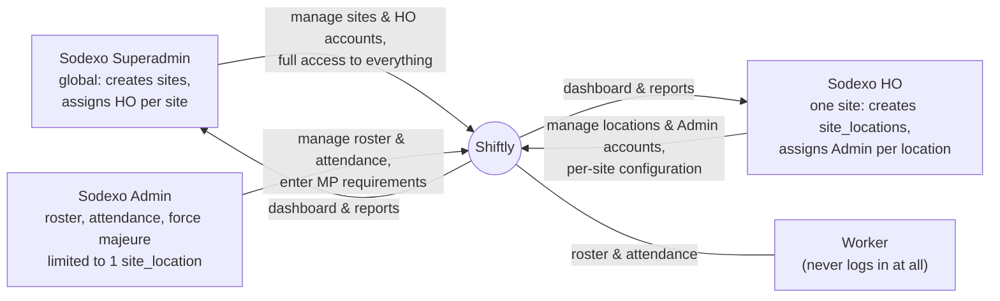
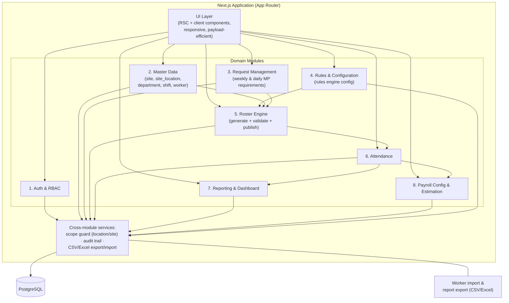
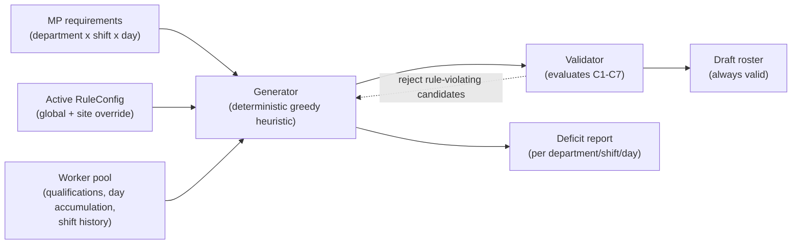
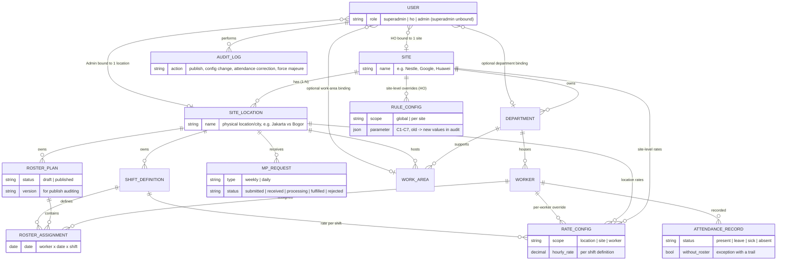
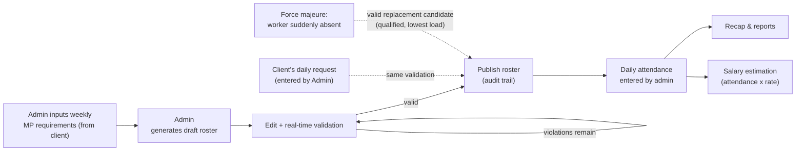

# Shiftly: Architecture Document

| | |
|---|---|
| Version | 0.3 |
| Source | Derived from PRD v0.2 |
| Status | Awaiting review; some decisions still TBD (see section 10) |
| Audience | Developers building Shiftly |

> This document describes the **target architecture**; the repo now implements its foundation — Better Auth with three roles, PostgreSQL via Drizzle ORM, and dashboard CRUD for sites, site_locations, users, workers, departments, and work areas (roster/attendance/reporting pages are descriptive stubs). Decisions that are not yet final remain marked **TBD** so they are not mistaken for agreed-upon choices.
>
> **Revision (Oct 2026):** the `client` entity was removed. The domain model is now `site` 1:N `site_locations`, with three roles — **superadmin** (full access), **HO** (one site), **admin** (one site_location). Operational data (departments, workers, MP requests, rates) lives at the location level.
>
> **Update (Oct 2026):** the formerly-TBD database (PostgreSQL), ORM/migrations (Drizzle), and session auth (Better Auth, email + password) are now decided and partially implemented — see sections 2, 6, and 10.
>
> **Revision (Oct 2026):** departments moved from the site_location level to the **site** level, and a new **work_area** entity was added. `department` is parented under `site`; `work_area` is scoped by both a `site_location` and a `department`, guarded by composite foreign keys that require the location and department to belong to the same site. Workers, MP requests, and rates remain at the location level.

---

## 1. Overview

Shiftly is a **multi-site & multi-location** web platform for roster and attendance management of Sodexo outsourced workers, starting with the Nestle pilot (Nestle, Google, Huawei are `site` rows in the data model). The architecture stands on four pillars:

1. A **deterministic Roster Engine** that auto-generates weekly draft rosters in compliance with all configurable work rules, and **refuses to publish rosters that violate rules** (unmet requirements are reported as explicit deficits, not silently violated).
2. **Scope-based isolation at the data level**: the superadmin has full access, each HO is bound to exactly one site (covering all its site_locations), each Admin to one site_location — and all queries are automatically scoped to the session's bound site/location on the server.
3. **Fully config-driven**: roster rules and salary rate structures are changed via configuration by HO, with no code changes.
4. **An audit trail** for sensitive decisions: roster publishing, configuration changes, attendance corrections, force majeure handling.

System context:



Workers are **never** users of the system. All input (roster and attendance) is performed by the Admin of the location. Clients (Nestle, Google, Huawei, …) have **no access** to the application — their MP requirements arrive via manual channels (email/WhatsApp) and are entered by the Admin.

The operational hierarchy: a **site** (e.g. Nestle) is managed by exactly **1 HO**; a site contains many **site_locations** (1:N); each site_location is managed by its own **Admin**.

---

## 2. Tech Stack

| Layer | Choice | Status |
|---|---|---|
| Framework | Next.js 16 (App Router) | Implemented |
| UI | React 19, Tailwind CSS 4, shadcn/ui | Implemented |
| Language | TypeScript | Implemented |
| Runtime / package manager | Bun | Implemented |
| Database | PostgreSQL 18 (docker compose for local & prod) | Implemented |
| ORM / migrations | Drizzle ORM + drizzle-kit (`drizzle/schema/`, `drizzle/migrations/`) | Implemented |
| Authentication | Better Auth — session-based (email + password), three roles; optional MFA in a later phase | Implemented (MFA not yet) |
| Hosting / deployment | Docker images (`Dockerfile`, `compose.prod.yaml`); external host | External host **TBD** |
| Tests | Bun's built-in test runner (`bun test`), DB-backed suites need the compose Postgres | Implemented |

Rationale for PostgreSQL (from the PRD): scheduling data is relational and query-rich, and data integrity matters for attendance and the audit trail.

---

## 3. High-Level Architecture

A modular monolith on Next.js App Router: one deployable, with clear module boundaries at the code level (not microservices). The heaviest core module (the Roster Engine) runs as pure server-side logic so it can be tested with property tests without I/O.



### Separation principles

- **Pure domain logic**: the generator, rule validator, and salary estimation calculations are written as pure functions (data in, results out), decoupled from UI and database. This is a prerequisite for the correctness and performance evaluation in section 5.
- **Scope-based isolation as a data-access layer**: not the "manual filter on every page" pattern, but a single centralized mechanism that forces all domain queries through the session's scope (location for Admin, site for HO, everything for superadmin) (section 7).
- **Configuration as data**: rules (C1–C7) and salary rates are stored as configuration rows, read by the engine at runtime, not hardcoded constants.

---

## 4. Core Modules and Responsibilities

| # | Module | Responsibilities | Primary users |
|---|---|---|---|
| 1 | Auth & RBAC | Login sessions, 3 roles (Superadmin, HO, Admin), binding users to sites/locations | All |
| 2 | Master Data | Site, site_location (location/city), department, shift definitions, worker (qualifications, PKWT/PKWTT, active status), user accounts per scope, CSV/Excel import | Superadmin (sites, HO accounts), HO (locations, Admin accounts), Admin (workers) |
| 3 | Request Management | Weekly & daily MP requirements entered by the admin on behalf of the client, request status | Admin, HO |
| 4 | Rules & Configuration | Global roster rule parameters (C1–C7) + per-site overrides, change history | HO |
| 5 | Roster Engine | Auto-generate drafts, real-time validation, block publishing while violations exist, explicit deficits, publish auditing | Admin |
| 6 | Attendance | Daily per-shift attendance input (present/leave/sick/absent), bulk input, corrections with a trail, attendance without a roster as an exception | Admin |
| 7 | Reporting & Dashboard | MP realization vs. requirement, workers approaching limits, attendance recap, export (per-location & cross-site views) | HO, Superadmin |
| 8 | Payroll Config & Estimation | Rate structure per shift/site/location/worker, salary estimation calculated from attendance, export | HO, Superadmin |

Module dependencies flow one way (the table above is ordered from upstream to downstream): Rules and Master Data feed the Roster Engine; the published output becomes the basis for Attendance; Attendance feeds Salary Estimation and Reporting. This direction is enforced so upstream modules never depend on downstream ones.

---

## 5. Roster Engine (Core Module)

The engine is **deterministic (rule-based), not generative AI**: output must be explainable and reproducible.

### 5.1 Internal components



- **Generator**: fills MP coverage requirements by selecting candidates that minimize violation risk (lightest load, furthest from work-day limits). Regeneration can be done per department without affecting other departments.
- **Validator**: a pure function that evaluates assignments against all active rules and returns violations **with specific reasons** ("5 work days this week already", "Shift 3 yesterday, mandatory day off", "Mandatory break not yet taken"). Used in two places: the generator (candidate selection) and the roster editor (real-time validation while the admin edits manually).
- **Publish gate**: a roster cannot be published while violations remain. Publishing writes an audit trail (who, when, roster version).

### 5.2 Configurable rules (C1–C7)

| ID | Rule | Default |
|---|---|---|
| C1 | Maximum work days per week per worker | 5 days (5+2 pattern) |
| C2 | Maximum work days per month per worker | 20 days |
| C3 | Forward shift rotation (1 → 2 → 3), no "dropping" to an earlier shift | active |
| C4 | After shift 3, the following day must be a rest day | active |
| C5 | Mandatory break trigger: accumulated work days since the last break | 60 work days |
| C6 | Mandatory break duration | 4 consecutive days |
| C7 | Workers only assigned within their department/qualification | active |

Global configuration can be overridden per site. Only HO (or superadmin) may change it, every change is logged (old value → new value), and changes only apply to rosters created afterward (not retroactive).

### 5.3 Evaluation strategy (engine acceptance criteria)

| Aspect | Target |
|---|---|
| Correctness | 0 violations in a simulation of 7 departments x up to 200 workers/department x 12 weeks, including full load |
| Coverage | >= 95% of MP requirements met; the remainder reported as an accurate deficit |
| Fairness | Difference in work-day distribution between workers within one department <= 2 days/month |
| Performance | Weekly roster generation for one site_location (worst case ~1,400 workers) < 30 seconds |

Because the engine is a pure function, all targets above are tested via unit/property tests without requiring UI or a database.

---

## 6. Data Model

Core entities (from PRD 4.1):



Schema design notes:

- **Implemented so far**: `site`, `site_location`, `user`, `department`, and `work_area` exist as real tables (`drizzle/schema/site-schema.ts`, `drizzle/schema/auth-schema.ts`, `drizzle/schema/department-schema.ts`) with FK-restricted parent references, `is_active` flags, and **soft delete** (`deleted_at` + partial unique indexes that ignore deleted rows). `site` and `site_location` carry `(id, site_id)` unique keys so the `work_area` composite FKs can enforce same-site scoping at the DB level. Better Auth adds its own `session`, `account`, and `verification` tables. All remaining entities below are still design-only.
- **Deletion guards**: a `site` is refused deletion while live departments exist under it; existing departments, site_locations, and users have their own guards (users check department/work-area bindings first).
- **No client entity**: the earlier Client → Site hierarchy was removed (Oct 2026 revision). What used to be "the client" (Nestle Group) is now a **site**; what used to be "a site with a city" is now a **site_location**. Client companies remain external counterparties — they convey MP requirements manually — but are not tables in the system.
- **Site is framework, location is operations**: a `SITE` carries its name and its HO binding; shift definitions, workers, MP requests, and location rates all live under `SITE_LOCATION`. Departments (Oct 2026 revision) are **site-level**: a `DEPARTMENT` belongs to one `site` and is shared by that site's `site_locations`.
- **Work areas**: a `WORK_AREA` sits at the intersection of a `SITE_LOCATION` and a `DEPARTMENT`. It carries denormalized `site_id` with composite foreign keys — `(department_id, site_id)` → `department` and `(site_location_id, site_id)` → `site_location` — so a work area physically cannot mix a department and a location from different sites. Partial unique `(site_location_id, name)` ignoring soft-deleted rows.
- **Multi-site & multi-location from day one**: every operational table carries a `site_location` reference (its site is derivable through it), so data isolation never depends on a "single site" assumption.
- **User bindings**: `role` ∈ (superadmin, ho, admin). The HO carries exactly one `siteId`; the Admin carries exactly one `siteLocationId`; the superadmin is bound to nothing and has full access. Users may additionally carry an optional `departmentId` and `workAreaId` (nullable FKs, delete-restricted; scoped management mirrors the department/work-area modules).
- **Versioned RosterPlan**: publishing creates a new version recorded in the audit trail; post-publish edits produce the next version.
- **AttendanceRecord without a roster**: attendance for a worker without a roster entry remains possible, flagged as an exception (dispensation) with a trail.
- **Hierarchical RuleConfig**: a global row as the base, per-site rows as overrides (managed by HO). The same resolution pattern is used by RateConfig (section 8).
- Configuration changes are **not retroactive**: a published roster stores the configuration context in effect when it was created.

---

## 7. Auth, RBAC, and Scope-Based Isolation

### 7.1 Roles

| Role | Binding | Access scope | Rights |
|---|---|---|---|
| Superadmin | — (unbound) | All sites & all their site_locations | Create sites, create HO accounts, global rule & rate configuration, full monitoring |
| HO | Exactly one site | All site_locations of that site | Create site_locations & Admin accounts for their site, per-site rule & rate overrides, monitoring & reporting within the site |
| Admin | Exactly one site_location | Only that location | Manage their location's roster, attendance, workers; enter MP requirements on behalf of the client |

Note: the client (e.g. Nestle) has no access to the application; MP requirements arrive via manual channels (email/WhatsApp) and are entered by the Admin. 1 site : 1 HO and 1 site_location : 1 Admin are the intended bindings.

### 7.2 Enforcement at the data level

The principle from PRD US-11: scoping is enforced **at the data/authorization level, not by hiding UI**. The implementation status:

1. Every user session carries its scope: superadmin = "all", HO = one site (covering all of its site_locations), Admin = one site_location — implemented in `lib/scope.ts` (`scopeOf`, `canManageUser`, `userScopeFilter`).
2. All access to operational data (workers, roster, attendance, MP requests, site configuration) goes through a single data-access layer that **must** inject the location filter (for Admin) or the site filter (for HO) from the session; superadmin bypasses filters. Domain modules have no query path that bypasses it. (Implemented for the user/site/location modules; the roster/attendance modules don't exist yet.)
3. Session-based authentication via Better Auth (email + password) on the server, mounted at `app/api/auth/[...all]/route.ts`; soft-deleted users are blocked from sign-in and their sessions evicted. Optional MFA in a later phase.

---

## 8. Rate Resolution and Salary Estimation

Rate resolution is hierarchical, from most specific wins:

```
per-worker override  →  location rate  →  site rate  →  global default
```

- Rates are defined **per shift** (shifts 1, 2, 3 differ) and can vary by location/city within a site (e.g. Nestle Jakarta vs Nestle Bogor) and by site.
- Salary estimate = recorded work hours/days (from attendance and published rosters) x the rate at the highest applicable resolution.
- Attendance changes (corrections, force majeure) automatically update estimates; recaps are available per worker, department, shift, location, site, and period, with Excel/CSV export for the existing payroll process.
- Architectural boundary: Shiftly stops at **estimation**. No deductions (BPJS, PPh21), no payslips, no payroll bookkeeping.

---

## 9. Key Data Flows



Two side paths (daily requests, force majeure) modify the running-day roster and **must pass the same validator** as the weekly roster, then are recorded in the audit trail.

---

## 10. Open Technical Decisions (TBD)

| # | Decision | Status |
|---|---|---|
| 1 | Database | **Decided (Oct 2026): PostgreSQL 18**, docker compose for local dev and prod bundles |
| 2 | Session auth library/approach | **Decided (Oct 2026): Better Auth** — session-based email + password |
| 3 | Hosting & deployment | Partially decided: Docker (`Dockerfile`, `compose.prod.yaml`); **external host still TBD** — before the pilot |
| 4 | ORM/schema migration tooling | **Decided (Oct 2026): Drizzle ORM + drizzle-kit** |
| 5 | Background job strategy (e.g. v1.1 notifications) | **TBD** — before v1.1 |

Decisions the PRD **has already locked** and are not being reopened: a deterministic engine (not generative AI), scope-based isolation at the data level (location for Admin, site for HO, full access for superadmin), the **Oct 2026 domain-model revision** (no client entity; `site` 1:N `site_locations`; roles superadmin/HO/admin; departments at the site level with `work_area` as the department x location junction; workers, MP requests, and rates at the location level), all rules config-driven, no worker self-service, no payslips/deductions.

Decisions made since (see the table above): PostgreSQL + Drizzle ORM, Better Auth session authentication, Docker for packaging.

---

## 11. Non-Functional Considerations

| Aspect | Architectural target |
|---|---|
| Daily operational pages | Per-shift attendance loads in < 2 seconds for ~200 workers; pagination and no heavy assets |
| Engine performance | Roster generation < 30 seconds for a full site (~1,400 workers) |
| Scale | ~7 departments x 200 workers per site_location; multi-site & multi-location correct in the schema from day one |
| Weak networks | Daily operational pages are payload-efficient (not a PWA/offline in v1; re-evaluated in v2.0) |
| 3-shift operations | No maintenance windows during operational hours without notice |
| Sensitive data security | Rates/salary editable by HO only, always audited, not exposed externally; worker personal data (NIK, etc.) access is restricted |

---

## 12. Roadmap Implications for the Architecture

| Phase | What it affects in the architecture |
|---|---|
| MVP (4–6 weeks) | Modules 1–6 plus rate configuration; scope-based isolation and the multi-site/multi-location schema **from the first commit**; engine + validator as pure functions so they can be verified before the Nestle pilot |
| v1.1 | Daily requests, force majeure, dashboard/export, full audit trail, salary estimation: no core schema changes, only new flows on top of the MVP foundation |
| v2.0 | New-site onboarding purely via master data (no new deployment); notifications (email/WA), API integration, PWA/offline: connection points are prepared through module separation, but not built in the MVP |

---

## 13. References

- PRD v0.2 (not part of the repo's published tree): source of all requirements, rules C1–C7, user stories, the Sept 17 discovery decisions, and the Oct 2026 domain-model revision (no `client`; `site` 1:N `site_locations`; roles superadmin/HO/admin).
- PRD appendix: interpretation of the discovery decisions that underpins the architectural choices in this document.
