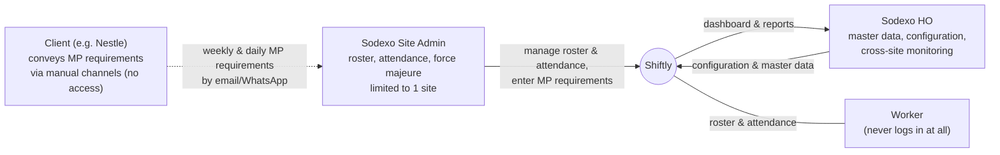
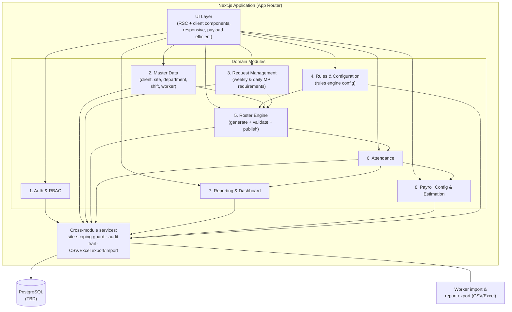
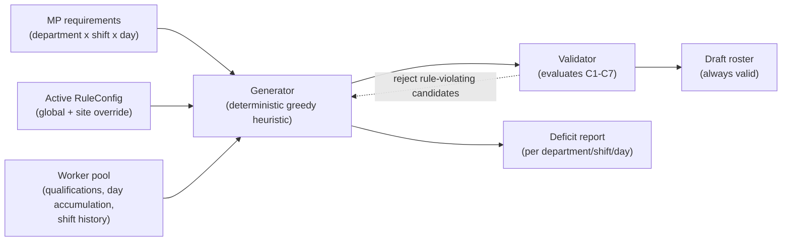
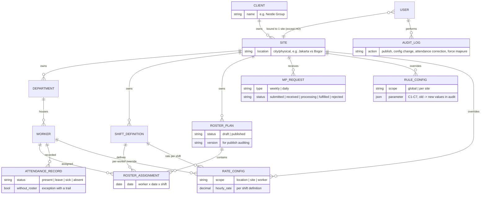
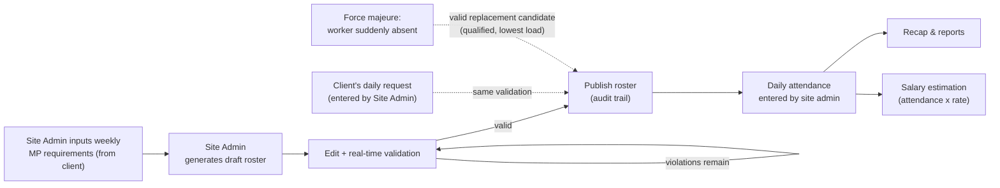

# Shiftly: Architecture Document

| | |
|---|---|
| Version | 0.1 (Draft) |
| Source | Derived from PRD v0.1 |
| Status | Awaiting review; some decisions still TBD (see section 10) |
| Audience | Developers building Shiftly |

> This document describes the **target architecture** (nothing is implemented yet; the repo is still a scaffold). All decisions that are not yet final are marked **TBD** so they are not mistaken for agreed-upon choices.

---

## 1. Overview

Shiftly is a **multi-client & multi-site** web platform for roster and attendance management of Sodexo outsourced workers, starting with the Nestle Group pilot. The architecture stands on four pillars:

1. A **deterministic Roster Engine** that auto-generates weekly draft rosters in compliance with all configurable work rules, and **refuses to publish rosters that violate rules** (unmet requirements are reported as explicit deficits, not silently violated).
2. **Site-scoping at the data level**: every non-HO user is bound to exactly one site, and all queries are automatically scoped to that site on the server.
3. **Fully config-driven**: roster rules and salary rate structures are changed via configuration by HO, with no code changes.
4. **An audit trail** for sensitive decisions: roster publishing, configuration changes, attendance corrections, force majeure handling.

System context:



Workers are **never** users of the system. All input (roster and attendance) is performed by site admins. Clients have **no access** to the application.

---

## 2. Tech Stack

| Layer | Choice | Status |
|---|---|---|
| Framework | Next.js 16 (App Router) | Scaffolded |
| UI | React 19, Tailwind CSS 4 | Scaffolded |
| Language | TypeScript | Scaffolded |
| Runtime / package manager | Bun | Scaffolded |
| Database | PostgreSQL (recommended by PRD) | **TBD** |
| Authentication | Session-based (email + password), optional MFA in a later phase | **TBD** |
| Hosting / deployment | | **TBD** |

Rationale for PostgreSQL (from the PRD): scheduling data is relational and query-rich, and data integrity matters for attendance and the audit trail.

---

## 3. High-Level Architecture

A modular monolith on Next.js App Router: one deployable, with clear module boundaries at the code level (not microservices). The heaviest core module (the Roster Engine) runs as pure server-side logic so it can be tested with property tests without I/O.



### Separation principles

- **Pure domain logic**: the generator, rule validator, and salary estimation calculations are written as pure functions (data in, results out), decoupled from UI and database. This is a prerequisite for the correctness and performance evaluation in section 5.
- **Site-scoping as a data-access layer**: not the "manual filter on every page" pattern, but a single centralized mechanism that forces all domain queries through the user's site scope (section 7).
- **Configuration as data**: rules (C1–C7) and salary rates are stored as configuration rows, read by the engine at runtime, not hardcoded constants.

---

## 4. Core Modules and Responsibilities

| # | Module | Responsibilities | Primary users |
|---|---|---|---|
| 1 | Auth & RBAC | Login sessions, 2 roles (Site Admin, HO), binding users to sites | All |
| 2 | Master Data | Client, site (with location/city), department, shift definitions, worker (qualifications, PKWT/PKWTT, active status), CSV/Excel import | HO, Site Admin |
| 3 | Request Management | Weekly & daily MP requirements entered by the site admin on behalf of the client, request status | Site Admin |
| 4 | Rules & Configuration | Global roster rule parameters (C1–C7) + per-site overrides, change history | HO |
| 5 | Roster Engine | Auto-generate drafts, real-time validation, block publishing while violations exist, explicit deficits, publish auditing | Site Admin |
| 6 | Attendance | Daily per-shift attendance input (present/leave/sick/absent), bulk input, corrections with a trail, attendance without a roster as an exception | Site Admin |
| 7 | Reporting & Dashboard | MP realization vs. requirement, workers approaching limits, attendance recap, export | HO |
| 8 | Payroll Config & Estimation | Rate structure per shift/site/location/worker, salary estimation calculated from attendance, export | HO |

Module dependencies flow one way (the table above is ordered from upstream to downstream): Rules and Master Data feed the Roster Engine; the published output becomes the basis for Attendance; Attendance feeds Salary Estimation and Reporting. This direction is enforced so upstream modules never depend on downstream ones.

---

## 5. Roster Engine (Core Module)

The engine is **deterministic (rule-based), not generative AI**: output must be explainable and reproducible.

### 5.1 Internal components



- **Generator**: fills MP coverage requirements by selecting candidates that minimize violation risk (lightest load, furthest from work-day limits). Regeneration can be done per department without affecting other departments.
- **Validator**: a pure function that evaluates assignments against all active rules and returns violations **with specific reasons** ("5 work days this week already", "Shift 3 yesterday, mandatory day off", "Mandatory break not yet taken"). Used in two places: the generator (candidate selection) and the roster editor (real-time validation while the admin edits manually).
- **Publish gate**: a roster cannot be published while violations remain. Publishing writes an audit trail (who, when, roster version).

### 5.2 Configurable rules (C1–C7)

| ID | Rule | Default |
|---|---|---|
| C1 | Maximum work days per week per worker | 5 days (5+2 pattern) |
| C2 | Maximum work days per month per worker | 20 days |
| C3 | Forward shift rotation (1 → 2 → 3), no "dropping" to an earlier shift | active |
| C4 | After shift 3, the following day must be a rest day | active |
| C5 | Mandatory break trigger: accumulated work days since the last break | 60 work days |
| C6 | Mandatory break duration | 4 consecutive days |
| C7 | Workers only assigned within their department/qualification | active |

Global configuration can be overridden per site. Only HO may change it, every change is logged (old value → new value), and changes only apply to rosters created afterward (not retroactive).

### 5.3 Evaluation strategy (engine acceptance criteria)

| Aspect | Target |
|---|---|
| Correctness | 0 violations in a simulation of 7 departments x up to 200 workers/department x 12 weeks, including full load |
| Coverage | >= 95% of MP requirements met; the remainder reported as an accurate deficit |
| Fairness | Difference in work-day distribution between workers within one department <= 2 days/month |
| Performance | Weekly roster generation for 1 site (worst case ~1,400 workers) < 30 seconds |

Because the engine is a pure function, all targets above are tested via unit/property tests without requiring UI or a database.

---

## 6. Data Model

Core entities (from PRD 4.1):



Schema design notes:

- **Multi-site from day one**: even though the pilot is a single site, every operational table carries a site reference so data isolation never depends on a "one site" assumption.
- **Versioned RosterPlan**: publishing creates a new version recorded in the audit trail; post-publish edits produce the next version.
- **AttendanceRecord without a roster**: attendance for a worker without a roster entry remains possible, flagged as an exception (dispensation) with a trail.
- **Hierarchical RuleConfig**: a global row as the base, per-site rows as overrides. The same resolution pattern is used by RateConfig (section 8).
- Configuration changes are **not retroactive**: a published roster stores the configuration context in effect when it was created.

---

## 7. Auth, RBAC, and Site-Scoping

### 7.1 Roles

| Role | Scope | Rights |
|---|---|---|
| Site Admin | Exactly one site | Manage their site's roster, attendance, workers; enter MP requirements on behalf of the client |
| Sodexo HO | All sites & clients | Master data, rule & rate configuration, monitoring, reporting |

Note: the client (e.g. Nestle) has no access to the application; MP requirements arrive via manual channels (email/WhatsApp) and are entered by the Site Admin.

### 7.2 Enforcement at the data level

The principle from PRD US-11: site-scoping is enforced **at the data/authorization level, not by hiding UI**. The intended implementation (target architecture):

1. Every user session carries its site scope (one site, or "all" for HO only).
2. All access to operational data (workers, roster, attendance, MP requests, site configuration) goes through a single data-access layer that **must** inject the site filter from the session. Domain modules have no query path that bypasses it.
3. Session-based authentication (email + password) on the server; optional MFA in a later phase. **TBD** until the auth decision.

---

## 8. Rate Resolution and Salary Estimation

Rate resolution is hierarchical, from most specific wins:

```
per-worker override  →  site rate  →  location rate  →  global default
```

- Rates are defined **per shift** (shifts 1, 2, 3 differ) and can vary by site and location/city.
- Salary estimate = recorded work hours/days (from attendance and published rosters) x the rate at the highest applicable resolution.
- Attendance changes (corrections, force majeure) automatically update estimates; recaps are available per worker, department, shift, site, and period, with Excel/CSV export for the existing payroll process.
- Architectural boundary: Shiftly stops at **estimation**. No deductions (BPJS, PPh21), no payslips, no payroll bookkeeping.

---

## 9. Key Data Flows



Two side paths (daily requests, force majeure) modify the running-day roster and **must pass the same validator** as the weekly roster, then are recorded in the audit trail.

---

## 10. Open Technical Decisions (TBD)

| # | Decision | Option recommended by PRD | When it must be final |
|---|---|---|---|
| 1 | Database | PostgreSQL | Before starting master data (first MVP weeks) |
| 2 | Session auth library/approach | Session-based email + password | Before the Auth & RBAC module |
| 3 | Hosting & deployment | TBD | Before the pilot |
| 4 | ORM/schema migration tooling | TBD (follows the DB choice) | Alongside #1 |
| 5 | Background job strategy (e.g. v1.1 notifications) | TBD | Before v1.1 |

Decisions the PRD **has already locked** and are not being reopened: a deterministic engine (not generative AI), site-scoping at the data level, all rules config-driven, no worker self-service, no payslips/deductions.

---

## 11. Non-Functional Considerations

| Aspect | Architectural target |
|---|---|
| Daily operational pages | Per-shift attendance loads in < 2 seconds for ~200 workers; pagination and no heavy assets |
| Engine performance | Roster generation < 30 seconds for a full site (~1,400 workers) |
| Scale | ~7 departments x 200 workers per site; multi-site correct in the schema from day one |
| Weak networks | Daily operational pages are payload-efficient (not a PWA/offline in v1; re-evaluated in v2.0) |
| 3-shift operations | No maintenance windows during operational hours without notice |
| Sensitive data security | Rates/salary editable by HO only, always audited, not exposed externally; worker personal data (NIK, etc.) access is restricted |

---

## 12. Roadmap Implications for the Architecture

| Phase | What it affects in the architecture |
|---|---|
| MVP (4–6 weeks) | Modules 1–6 plus rate configuration; site-scoping and the multi-site schema **from the first commit**; engine + validator as pure functions so they can be verified before the Nestle pilot |
| v1.1 | Daily requests, force majeure, dashboard/export, full audit trail, salary estimation: no core schema changes, only new flows on top of the MVP foundation |
| v2.0 | New-site onboarding purely via master data (no new deployment); notifications (email/WA), API integration, PWA/offline: connection points are prepared through module separation, but not built in the MVP |

---

## 13. References

- PRD v0.1: source of all requirements, rules C1–C7, user stories, and the Sept 17 discovery decisions.
- PRD appendix: interpretation of the discovery decisions that underpins the architectural choices in this document.
